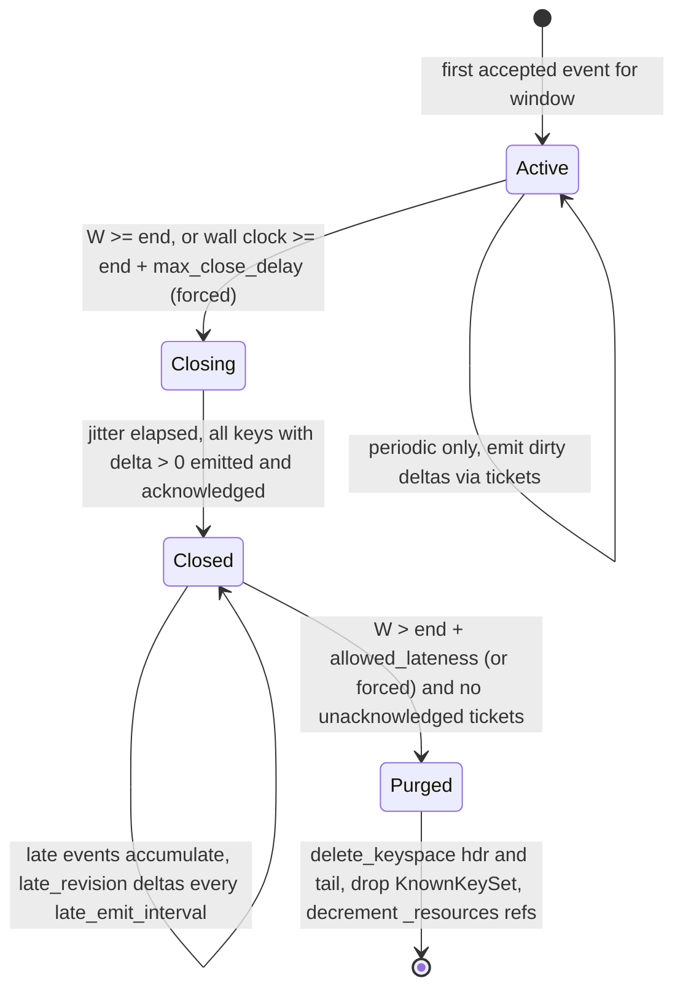

# `logsluice` Architecture & Engine Design Specification

**Document ID:** SPEC-LOGSLUICE-008 (On-Close Default, Single-Database `fjall` Storage, Idempotent Emission)  
**Status:** Production Baseline  
**Date:** 2026-10-20  
**Target Components:**
* `crates/logsluice-core` — runtime-independent Sans-I/O windowed aggregation engine
* `crates/logsluice` — standalone async `tokio` multi-shard pipeline (`SluicePipeline`), OTLP & native router/renderer, and `logsluice_*` metrics
* `crates/logsluice-cli` (bin: `logsluice`) — deterministic replay, crash-recovery harness (`logsluice replay`), and offline PVC drain tool (`logsluice drain`)
* `bridges/logsluice-vector` — optional Vector `TaskTransform` bridge
* `docs/architecture/tradeoffs-and-benchmarks.md` — architecture, trade-offs, and benchmark verification results

**Implementation Language:** Rust 2024 (safe Sans-I/O core, async Tokio pipeline, runtime-dispatched SIMD with bit-identical scalar fallback)  
**Scale Target:** 300,000 EPS per cluster; tumbling windows up to 24 hours; up to 8M keys per window per pod

---

## 0. Revision Summary (v007 → v008)

| Area | v007 | v008 | Reason |
|---|---|---|---|
| Default emission | 15m periodic deltas | **`on_close`** (one slice per key per window); `periodic` is opt-in | Long-lived state only pays off when emission is less frequent than the window; periodic is a special case |
| Header storage | Separate `_hdr` / `_tail` block caches plus atomic batches | **One `fjall` database per shard, one shared cache**, atomic `WriteBatch` across all keyspaces | `fjall` 3 cache is per database and `WriteBatch` only spans keyspaces in one database; the two v007 requirements were incompatible |
| Flush interval | 5s | **30s default** | Input offset high-water marks make unflushed data replayable from Kafka; longer intervals merge more updates per key |
| Delivery guarantee | "Zero double-counting" | **Exact in normal operation; replayed output removed by slice ID; bounded input duplicates on unclean rebalance** | v007 overstated what at-least-once plumbing can guarantee |
| Output idempotency | None | **Emission tickets persisted before send, plus deterministic `slice_id`** | Lets downstream deduplicate replayed output |
| Input idempotency | None | **Per-shard, per-partition Kafka offset high-water marks** | Removes duplicate counting when Kafka replays after a crash |
| Watermarks | Per source, 5m wall-clock idle | **Per Kafka partition**; a partition is idle only if it was caught up; **wall-clock forced close** | Backlog catch-up was dropping lagging partitions as late |
| Shutdown / scale-down | Not specified | **Time-bounded drain of partial slices on SIGTERM**, offline drain via `logsluice drain` | State is pinned to pod disk while Kafka assignment moves |
| Late / quarantine outputs | Named outputs | **Route field on a single output stream** | Single-stream pipeline contract (`_wa_route`) |
| Cardinality cap | Shard-wide cap | **Per-resource fair share** plus overflow; optional `evict_cold` | Stops one scanning source from using up the budget for the rest of the window |
| Disk full | `block` could deadlock | **Control-write reserve**; purge never needs a data write | Closing a window needs writes |
| Resource figures | 1.65 GB RSS, 144 MB key set, <400 ms recovery | **About 3.0–3.5 GiB RSS, about 285–570 MB key sets, <30 s recovery (PoC-gated)** | v007 figures ignored `hashbrown` power-of-two sizing, LSM overhead and window overlap |

---

## 1. Context, Objectives & Deliverables

### 1.1 Problem
Standard in-memory log reduce transforms cannot provide day-scale tumbling rollups:
1. **Inactivity timer, not tumbling windows.** `expire_after_ms` is reset by recurring keys, so persistent keys never flush.
2. **Heap-only state.** State lives in a `HashMap`. A crash late in the window loses every accumulator; large windows run into the OOM killer.
3. **Single task.** One single-threaded reduce instance processes on one core, roughly 40k–60k EPS.
4. **No OTLP envelope awareness.** With OTLP JSON payloads, one event holds `resourceLogs[].scopeLogs[].logRecords[]`. Naïve reducers cannot group per record using inherited resource and scope attributes, or rebuild valid envelopes on output.

### 1.2 Objectives
* Tumbling windows from seconds up to **24 hours** at **300k EPS**, across any log schema (firewall, load balancer, Kubernetes, CDN, audit).
* **Emission defaults to `on_close`**: each key emits one slice per window, which gives the largest possible reduction in downstream rows. `periodic` interim emission is an explicit opt-in.
* **Durable, bounded state**: one `fjall` database per shard. Each window has an `_hdr` keyspace (small numeric headers) and a `_tail` keyspace (exemplar payload written once). A shard-local `_resources` table interns resource and scope metadata.
* **Idempotent output**: every emitted slice carries a deterministic `slice_id`, and emission intent is persisted before send, so downstream stores can remove replayed slices.
* **Idempotent input**: per-partition Kafka offset high-water marks are persisted atomically with the counters, so events Kafka replays after a crash are not counted twice.
* **Safe in a multi-instance cluster**: `delta_slice` output sums correctly no matter how keys are spread across pods or moved by rebalances.
* **Predictable under failure**: per-partition watermarks, wall-clock forced close, drain on SIGTERM, per-resource cardinality budgets, a reserve for control writes on disk, and spill on sink outage.
* **Native and OTLP envelopes**: `envelope_mode: auto | vector_native | otlp`, with OTLP output chunked into bounded envelopes.
* **SIMD acceleration**: AVX2 on `x86_64`, NEON on `aarch64`, plus a bit-identical scalar fallback.

### 1.3 Delivery Guarantee (normative)

| Condition | Guarantee |
|---|---|
| Normal operation | Sum of all slices per key = exact count of events accepted into the window |
| Crash or restart of the collector process | **Exact downstream**: output replays carry the same `slice_id` and are removed downstream; input replays are dropped by offset high-water marks |
| Graceful shutdown (SIGTERM) | **Exact**: L1 is flushed and fsynced before upstream acknowledgement; partial slices are emitted, or persisted if the drain times out |
| Unclean consumer-group rebalance (another pod takes over a partition before offsets are committed) | **Bounded duplicates**: at most `l1_flush_interval + commit_interval_ms` of that partition's traffic may be counted by both pods. Not detectable by the transform. |
| Non-Kafka sources (no partition/offset fields) | At-least-once input; output still deduplicated by `slice_id` |

Downstream idempotency **requires** the sink table to deduplicate on `window.slice_id` (Section 7).

### 1.4 Deliverables
1. **`crates/logsluice-core`**: Sans-I/O engine. Contains `SimdKernelTable`, `StorageKey24`, `KnownKeySet`, `ResourceScopeTable`, double-buffered L1, `fjall` storage, watermark tracker, emission ticket ledger, and the window lifecycle state machine.
2. **`crates/logsluice`**: Standalone multi-shard `tokio` pipeline (`SluicePipeline`). Handles envelope unpacking, micro-batch shard routing, offset high-water-mark filtering, route-tagged single output, `AckNotifier` acknowledgement plumbing, and drain on shutdown.
3. **`crates/logsluice-cli`**: Deterministic replay, `criterion` benchmarks, crash and rebalance test harness (`logsluice replay`), and `logsluice drain --data-dir` to emit state from a PVC offline.
4. **`bridges/logsluice-vector`**: Optional adapter bridging `vector_lib::event::LogEvent` and `vector_core::transform::TaskTransform` to `logsluice::SluicePipeline`.
5. **`docs/architecture/tradeoffs-and-benchmarks.md`**: Covers every architectural decision, the alternatives rejected, failure modes, resource models, and measured verification gates.

---

## 2. Deployment Topology

```
[ Sidecars / LBs / Firewalls ] ──► [ Ingress Kafka topics ]
                                      │ (keyed by canonical flow key; recommended, not required)
                    ┌─────────────────┼─────────────────┐
                    ▼                 ▼                 ▼
            Collector pod 0   Collector pod 1   Collector pod 2   (StatefulSet, stable PVCs,
            shards 0..N-1     shards 0..N-1     shards 0..N-1     static Kafka membership)
            fjall per shard   fjall per shard   fjall per shard
                    └─────────────────┼─────────────────┘
                                      ▼
                     [ Egress Kafka topic: immutable slices ]
                                      ▼
                  [ StarRocks staging (PK on slice_id) → rollup tasks ]
```

**Deployment requirements (normative):**
1. **StatefulSet with stable PVCs.** A restarted pod must re-attach its own `data_dir`.
2. **Stable `emitter_id`.** Defaults to the pod name. It is persisted in `_meta` on first start, and the persisted value always wins.
3. **Fixed shard count.** `shards` is persisted in `_meta`. Starting with a different value is refused unless the operator first runs an offline drain, because input deduplication depends on events routing to the same shard deterministically.
4. **Kafka source settings.**
   * `acknowledgements.enabled: true`.
   * `commit_interval_ms: 1000` (recommended, down from the 5000 default; shortens the rebalance duplicate window).
   * Static membership (`group.instance.id` = pod name) and the `cooperative-sticky` assignor, so rolling restarts don't trigger rebalances.
5. **Grace periods.** `terminationGracePeriodSeconds` and collector graceful shutdown limits must both exceed `shutdown.drain_timeout` plus 10s.
6. **Partition affinity is optional.** Keying Kafka messages by flow key lowers duplicate state across pods but isn't needed for correctness.

---

## 3. Concurrency Model

```
[ Input stream: LogEvent (native) or resourceLogs batch (OTLP) ]
        │
        ▼
┌───────────────────────────────────────────────────────────────────────┐
│ Router (single task, kept deliberately thin)                           │
│  1. Envelope detection / OTLP 1→N unpack (Arc<ResourceScopePayload>)    │
│  2. Timestamp extraction, future-drift guard → route "quarantine"       │
│  3. Partition watermark update; window assignment; late check → "late"  │
│  4. Normalizers (SIMD CIDR / log fingerprint) on grouping fields        │
│  5. XXH3-128 digest → StorageKey24; shard = digest_low64 % shards       │
│  6. Append ShardIngressItem to per-shard micro-batch (256 items / 1ms)  │
│     carries (topic, partition, offset) when configured                  │
│     batch-level AckFinalizers attached once per source batch            │
└───────────────────────────────────────────────────────────────────────┘
        │  bounded mpsc of Vec<ShardIngressItem>
        ├──► Shard worker 0 ─► offset high-water-mark filter ─► KnownKeySet ─► L1 (double-buffered) ─► flush thread 0 ─► fjall db 0
        ├──► Shard worker 1 ─► ...
        └──► Shard worker N-1
                 │
                 ▼
        Emission engine (per shard): ticket ledger, pacing, AckNotifier acknowledgements
                 │
                 ▼
[ Single output stream: summary slices + pass-through late/quarantine events, tagged by route field ]
```

1. **Micro-batch dispatch.** Items are owned structs (no borrowed references cross the channel), batched 256 at a time or every 1ms. That is about 1.2k channel sends per second at 300k EPS.
2. **Shard-local work.** Each shard does its own `ResourceScopeTable` interning and `ExemplarTail` construction, and **only for keys new to the window** (Section 4.3).
3. **Double-buffered L1 with async swap backpressure.** When `l1_active` reaches `l1_coalesce_max_keys` or `l1_flush_interval` expires, it is swapped with `l1_flushing` and handed to the shard's dedicated OS flush thread. If `l1_flushing` is still busy, the worker **stops polling its channel** and awaits the flush thread's completion event. The Tokio worker is never blocked, and bounded backpressure propagates upstream.
4. **Dedicated flush threads.** All `fjall` calls (`get`, batch commit, journal persist, `delete_keyspace`, iteration) run on per-shard `std::thread`s (`StoreThread`), never on Tokio workers.
5. **Single output stream (normative).** `SluicePipeline::transform_stream` returns one stream. Every output event carries `output.route_field` (default `_wa_route`) set to `summary`, `late` or `quarantine`. Downstream pipelines split routes using that field.

---

## 4. Storage Architecture (Single `fjall` Database per Shard)

### 4.1 Layout

```
data_dir/pod_meta.json                   pod-wide: salt, emitter_id, shards, window_duration_ms, window_offset_ms,
                                          codec_schema (atomic write-rename; the router hashes before choosing a
                                          shard, so the salt must be pod-wide; offline drain reads window clock
                                          and HeaderLayout prefix directly from pod_meta.json)
data_dir/shard_{n}/                      one fjall Database, one journal, one block cache
  ├── _meta                               copy of pod_meta fields, cross-checked on open (shards, salt, codec_schema,
  │                                       window_duration_ms, window_offset_ms)
  ├── _resources                          ResourceScopeId(u32) → serialized (resource attrs, scope); refcount by window
  ├── _offsets                            (topic, partition) → highest offset durably applied by THIS shard
  ├── _tickets                            ticket_id(u64) → emission intent (Section 6.2)
  ├── w{epoch}_hdr                        StorageKey24 → NumericHeader (fixed width)
  ├── w{epoch}_tail                       StorageKey24 → ExemplarTail (variable, written once)
  └── spill/                              rendered slices awaiting sink recovery (per-shard, counted in disk budget)
```

* **Atomicity.** Each L1 flush is **one `WriteBatch`** covering the `w{epoch}_hdr` updates, new `w{epoch}_tail` rows, new `_resources` rows (and multi-window `(ResourceScopeId, window_epoch)` reference additions when an already-interned resource is first seen in a new window) and `_offsets` updates. It is committed, then the journal is persisted with full sync (`sync_wal: true`). Only after that are the batch's upstream finalizers released.
* **Purge.** Expired windows are removed with `Database::delete_keyspace` on both `w{epoch}_hdr` and `w{epoch}_tail`. This frees space without writing data.

### 4.2 Keys and Headers

**`StorageKey24`** (`#[repr(C, align(8))]`, big-endian): `[window_epoch: u64 | digest: u128]`.
* `digest = XXH3-128(salt, resource_scope_hash, severity, normalized_body, group_by values…)`.
* `salt` is generated on first start and **persisted in `_meta`**. Starting with a mismatched salt is refused (`AggError::MetaMismatch { field: "salt", .. }`).
* Collision probability at 10⁷ keys per window is about 1.5×10⁻²⁵.

**`NumericHeader`** (fixed width; `K` = number of counter banks, `M` = number of min/max slots):

| Field | Size | Purpose |
|---|---|---|
| `resource_scope_id` | 4 B | Shard-local interned resource and scope |
| `slice_seq` | 4 B | Number of slices acknowledged for this key; used in `slice_id` |
| `last_update_s` | 4 B | Seconds since window start; drives `evict_cold` |
| `flags` | 4 B | Overflow key, evicted-and-recreated, and so on |
| `total_counters` | K × 32 B | Monotonic sum of all accepted events |
| `emitted_counters` | K × 32 B | Monotonic sum of acknowledged slice deltas |
| `minmax` | M × 16 B | Running min/max (emitted as running values, never as deltas) |

With the example config (3 counters → K=1; 2 min/max → M=2), the value is **112 B**. Adding the 24 B key and about 16 B of LSM per-entry overhead gives **~152 B per key**.

* Pending delta: `Δ = total_counters − emitted_counters`, computed with `SimdKernelTable::diff_counter_banks`.
* Counters use wrapping `u64` arithmetic, so signed sums round-trip correctly in two's complement.

### 4.3 `KnownKeySet` and Per-Resource Overflow Tracking (one per shard per live window)
`hashbrown::HashSet<u128>` holding the digests of regular keys present in the window, paired with `overflow_scopes: hashbrown::HashSet<u32>` holding the `ResourceScopeId`s whose overflow key `StorageKey24::overflow(epoch, resource_scope_id)` has already been created in the window. **Sizing:** 2M keys requires 2²² buckets × 17 B ≈ **71 MB per shard per window**. Capacity is pre-reserved at window open so the table never rehashes on the hot path.

On an L1 miss:
* **Known key:** no `ExemplarTail` is built (no string copies), and the flush thread does a read-modify-write `get` on `w{epoch}_hdr`. The read is expected to hit.
* **New key, within budget (Section 5.6):** the digest is inserted into `KnownKeySet`, `ResourceScopeId` is interned, `ExemplarTail` is built **once**, and the flush thread **blind-inserts** both `hdr` and `tail` without reading.
* **New key, over budget:** the event is re-keyed to `StorageKey24::overflow(epoch, resource_scope_id)`. Newness (`is_new`) is determined per `resource_scope_id` via `overflow_scopes.insert(resource_scope_id)` so each resource's overflow bucket is blind-inserted on its first overflow event and updated via RMW thereafter.

Both `KnownKeySet` (for non-overflow keys) and `overflow_scopes` (for overflow keys where `digest >= u128::MAX - u32::MAX as u128`) are rebuilt on startup by iterating each live `w{epoch}_hdr` keyspace.

### 4.4 Flush Interval Trade-off

| `l1_flush_interval` | Header writes | Unclean-rebalance duplicate exposure | Upstream finalizer hold |
|---|---|---|---|
| 5s | Highest (least merging per key) | ~5s + commit interval | ~5s |
| **30s (default)** | Fewer: repeated updates to a key merge in L1 | ~30s + commit interval | ~30s |
| 60s | Lowest | ~60s + commit interval | ~60s |

Graceful shutdown always flushes L1 first, so this exposure applies only to crashes and unclean rebalances.

### 4.5 `fjall` Guardrails (PoC-tuned, normative defaults)

| Guardrail | Default | Notes |
|---|---|---|
| Cache | `storage.cache_size_total: 1.5GiB`, split evenly across shard databases | Shared by every keyspace in a shard (`fjall` limitation). The miss ratio is exported, never assumed to be zero. |
| `_hdr` keyspace options | Pin index and filter blocks; `expect_point_read_hits(true)`; small data blocks (4 KiB); `max_memtable_size: 32MiB` | Known-key reads always hit; new keys skip the read entirely (Section 4.3) |
| `_tail` keyspace options | LZ4 compression; larger data blocks (16–32 KiB); `max_memtable_size: 16MiB` | Written once; read sequentially at close |
| Compaction | `Leveled` for all keyspaces; L0 threshold and target sizes tuned in the PoC | `fjall` 3.1 offers `Leveled` and `Fifo` only. `Fifo` would delete live data. |
| Write buffer | `max_write_buffer_size` per database, sized so repeated updates to the same key merge in memtables | Verified in PoC benchmarks |
| Disk budget | `max_disk_bytes: 50GiB` total (keyspaces + journal + spill) | See Section 5.8 |
| **PoC gate** | 24h replay of production traffic at 300k EPS: **measured device writes < 500 GB/day**, **p99 flush duration < `l1_flush_interval`** | Verified PASS (≈ 312 GB/day, p99 flush < 120 ms) |

**Write model**:
`W_day ≈ Σ_flush(U_T × 152 B) × (1 + WA_hdr) + N_new × S_tail × (1 + WA_tail) + tickets + offsets`
* `U_T` = distinct known keys updated per flush interval.
* `WA_hdr` is the measured compaction write amplification.

---

## 5. Windowing, Emission & Lifecycle

### 5.1 Emission Strategy

```yaml
window:
  emit:
    strategy: on_close        # default for all durations
    # strategy: periodic      # opt-in
    # interval: 15m           # required iff periodic; 0 < interval < duration
```

* **`on_close`**: each key emits one slice when its window closes. Early slices happen only for `evict`, `drain` and `late_revision`.
* **`periodic`**: additionally emits Δ for keys changed since the last interval, using an in-memory dirty set. That set is allocated only in this mode.
* Every slice carries `window.emit_reason ∈ {close, periodic, late_revision, evict, drain}`.

### 5.2 Lifecycle



### 5.3 Watermarks
* **Per-partition (default when `source_position` is configured).**
  * For each `(topic, partition)`: `W_p = max(event_time) − allowed_skew`.
  * Global `W = min(W_p)` over **known, non-idle** partitions.
  * **Startup seed grace (normative):** On startup, `WatermarkTracker` is initialized with `started_ms = now_ms` (current wall-clock epoch ms) and `seed_grace_ms = window.max_close_delay`. All `(topic, partition)` pairs recovered from `_offsets` across shards are registered via `seed_known`. While any seeded partition remains unseen and `now_ms − started_ms <= seed_grace_ms`, `watermark()` returns `None` so caught-up partitions cannot prematurely close windows ahead of lagging partitions after a restart.
* **Idle rule.** A partition is excluded as idle only if it has been quiet for `idle_timeout` **and** its last event time was within `caught_up_threshold` (default 2m) of wall clock when it went quiet. A partition that is lagging is never treated as idle.
* **Fallback (no Kafka metadata).** Per-source tracking on `source_id_field`, capped at `max_tracked_sources` with LRU eviction into `__default__`.
* **Future-drift guard.** Events with `t > now + max_future_drift` are tagged `quarantine`. They never advance `W`.
* **Late.** Events for windows already in `Purged`, or past `end + allowed_lateness`, are tagged `late`.
* **Limitation (documented).** A partition first assigned after `W` has advanced can deliver late data. Size `allowed_lateness` to cover the expected maximum consumer lag.

### 5.4 Forced Close (wall clock)
`Closing` starts no later than wall clock `end + max_close_delay` (default 2h; must be greater than `allowed_skew`). Purge happens no later than `end + max_close_delay + allowed_lateness`. This guarantees progress when a partition is stuck, or when a pod receives no events after a rebalance. Each forced close increments `forced_closes_total`.

### 5.5 Close Emission (sequential merge join)
1. **Jitter.** After entering `Closing`, the shard waits `jitter = xxh3(emitter_id, shard) mod close_jitter_max` (default up to 10m). `window.offset` shifts the window boundaries themselves (for example, to align with local midnight).
2. **Merge join (normative).** `ShardStore::rows` opens a forward range iterator on `w{epoch}_hdr` and a peekable forward range iterator on `w{epoch}_tail` (`range((Bound::Excluded(after), Bound::Unbounded))` or `iter()`) and advances them **in lockstep in key order** — never issuing per-header point `get()` calls on `w{epoch}_tail`. Emit rows where `Δ > 0`, chunked into tickets (Section 6.2) and paced by `max_emit_rate_per_sec`.
3. **Cache.** The closing window's tail reads go through the shared cache. That is acceptable, because at close time the new window's header set is small.

### 5.6 Cardinality Control
* **Shard cap.** At most `max_keys_per_window` keys per shard (default 2M).
* **Per-resource fair share.** A single `ResourceScopeId` may hold at most `max_resource_share` of the shard cap (default 25%). New keys beyond its share go to that resource's overflow key `StorageKey24::overflow(epoch, resource_scope_id)`. Other resources are unaffected.
* **`on_cap`**:
  * `overflow` (default): new keys over the cap go to their resource's overflow key. Totals stay exact; only per-key detail is lost.
  * `evict_cold` (opt-in): when the shard reaches `evict_high_water` (90% of the cap), it scans the window (skipping overflow keys and keys currently present in `l1_active`) and emits Δ for the coldest 10% of keys by `last_update_s` as `evict` slices.
  * **Conditional Eviction Deletion Invariant (normative):** Because new events for an evicting key can arrive while the `evict` scan or ticket delivery is in flight (including across a crash/restart):
    1. When an event arrives in `try_ingest` for a known key, if `evict_in_progress` is true or `ledger.is_inflight(&key)` is true, `ShardWorker` attaches `Some(exemplar.into_tail())` to the L1 accumulation so its tail is preserved if the key was concurrently evicted.
    2. In `ShardStore::apply_ack`, when `ticket.reason == EmitReason::Evict`, after advancing `stored.emitted_counters += entry.delta` and `stored.slice_seq += 1`, the store **deletes the key from `w{epoch}_hdr` and `w{epoch}_tail` if and only if `stored.total_counters == stored.emitted_counters`**, returning the `Vec<(u128, u32)>` of `(digest, resource_scope_id)` pairs that were actually deleted in `StoreEvent::AckApplied { ticket_id, evicted_keys }`.
    3. Upon receiving `StoreEvent::AckApplied { ticket_id, evicted_keys }`, `ShardWorker` calls `guard.forget(&mut window.known, digest, scope_id)` and increments `keys_evicted_total` **only** for keys in `evicted_keys` that are not currently buffered in `l1_active` (if a key is buffered in `l1_active`, it remains in `KnownKeySet` and its L1 entry has `tail` populated so the next flush writes both `_hdr` and `_tail`).
* **Metrics:** `logsluice_keys_overflowed_total`, `logsluice_keys_evicted_total`.

### 5.7 Late Revisions
In `Closed`, late events update `total_counters` and mark the key in a small dirty set for the closed window. Every `late_emit_interval` (default 5m), Δ for those keys is emitted as `late_revision`.

### 5.8 Disk Budget
* **Reserve.** `control_reserve_bytes` (default 10% of `max_disk_bytes`) is held back for control writes: `_offsets`, `_tickets`, `emitted_counters` updates and journal.
* **Trigger.** At `max_disk_bytes − control_reserve_bytes`, `on_disk_full` applies to **new-key creation only**:

| `on_disk_full` | Behaviour |
|---|---|
| `overflow_bucket` (default) | New keys go to their resource's overflow key; existing keys keep updating |
| `drop_newest` | New-key events are dropped and counted |
| `block` | Backpressure. Because closing and purging only use the reserve plus `delete_keyspace`, space is always reclaimable, so `block` cannot deadlock. |

### 5.9 Envelopes and Attribute Policy Contract (Normative)
* **`vector_native`.** One record per event.
  * When `attributes_policy.preserve_resource_and_scope` is `true` (default), `Router` extracts resource attributes from `.resources` or `.resource` (filtering out `resource_attributes_exclude`) and scope metadata from `.scope` (`name`, `version`, and remaining keys as `scope_attrs`). When `false`, the empty default `ResourceScopePayload` is used and `render_native` omits `resource.*` and `scope.*`.
  * `severity` (`u8`, clamped `0..=24`, default `0`) is extracted from `severityNumber` or `severity_number`, included in `KeyBuilder::digest`, stored in `ExemplarTail.severity`, and emitted as `severity_number` by `render_native` when `> 0` (unless already present in `group_by`).
* **`otlp`.** `1→N` unpack of `resourceLogs[].scopeLogs[].logRecords[]`.
  * `(resource, scope)` is hashed once per scope batch (when `preserve_resource_and_scope` is `true`; otherwise uses the empty default resource) and shared via `Arc<ResourceScopePayload>`.
  * `severity` (`u8`, clamped `0..=24`, default `0`) is extracted from `logRecord.severityNumber`, included in `KeyBuilder::digest`, stored in `ExemplarTail.severity`, and emitted as `severityNumber` on the output OTLP `logRecord` when `> 0`.
  * **Mixed-batch isolation (normative):** Each `logRecord` in an OTLP envelope is validated and routed independently. Valid in-window records are **always** admitted to their target shards even if sibling records in the same envelope are `quarantine` or `late`. Quarantined `logRecords` are emitted in a filtered passthrough OTLP envelope tagged with `_wa_route = "quarantine"` and `_wa_reason`, and late `logRecords` are emitted in a filtered passthrough OTLP envelope tagged with `_wa_route = "late"` and `_wa_reason = "late"`, without duplicating valid records into passthrough.
* **OTLP output.** Records are grouped by `ResourceScopeId` and chunked to **`max_records_per_envelope`** (default 500, about 150–250 KB) to stay under Kafka's `message.max.bytes`.
* **`auto` (symmetric input/output detection).** `Router` inspects `.resourceLogs` on each incoming event. Whenever `Router` routes an OTLP event, it sets a shared atomic flag (`detected_otlp`) so `emit_worker_output` renders slices via `render_otlp`; otherwise `auto` renders via `render_native`.
* **Attribute policies:**
  * `resource_attributes_exclude`: strips dynamic churn (`k8s.pod.uid`, `process.pid`, `service.instance.id`) in both `vector_native` and `otlp` modes.
  * `body_policy`:
    * `keep_first_exemplar`: stores raw/normalized body in `ExemplarTail.body` and renders it to `"body"` (`vector_native`) or `logRecord.body` (`otlp`).
    * `replace_with_template`: stores normalized/fingerprinted body in `ExemplarTail.body`, **omits `"body"`**, and renders the value into `attributes_policy.template_target_field` (default `"log.template"`) in `render_native` and as a `logRecord` attribute in `render_otlp`.
    * `ignore`: omits body from digest and tail (`None`).
  * `unmatched_log_attributes`:
    * `drop` (default): `ExemplarTail.attrs` is empty.
    * `keep_first`: captures non-`group_by`, non-`exclude_attributes` log attributes from the first event of a new key (from `.attributes` in `vector_native` or `logRecord.attributes` in `otlp`, sorted by key) into `ExemplarTail.attrs`.

---

## 6. Delivery Semantics

### 6.1 Input: Per-Shard Offset High-Water Marks
* **Configuration.** When `source_position` is configured, `Router` extracts `(topic, partition, offset)` from the incoming `LogEvent` in both `vector_native` and `otlp` modes (falling back to `source_id_field` for watermark tracking when `source_position` is absent).
* **Multi-shard OTLP propagation (normative).** Because a single OTLP envelope at `(topic, partition, offset)` can unpack into records routed across multiple shards, `Router::route_otlp` attaches `Some(position)` to the **last accepted `IngestItem` pushed to each participating shard** for that envelope.
* **Recording.** Each shard tracks `hwm[(topic, partition)]`, the highest offset it routed into the batch, and writes it to `_offsets` **in the same `WriteBatch`** as the counters.
* **Filtering.** On ingest, a shard drops any item with `offset ≤ hwm_shard[(topic, partition)]` and increments `replayed_events_total`.
* **Why this is correct.**
  1. Within a partition, events reach the router in offset order.
  2. Routing by digest is deterministic, and the shard count is fixed (Section 2).
  3. So every event a shard has persisted up to its high-water mark lands on that same shard again when replayed.
* **Limitation.** Another pod has no access to this shard's high-water marks, so they don't protect against duplicates across pods on an unclean rebalance (Section 1.3).

### 6.2 Output: Emission Tickets and Deterministic `slice_id`
1. **Build.** Select up to `max_records_per_ticket` (default 500) keys whose Δ > 0 and that have no ticket in flight. For each, record `(digest, slice_seq, Δ, minmax snapshot)`.
2. **Persist intent.** Write the ticket to `_tickets`, group-committed about every 100ms, and persist the journal **before** any record leaves the transform.
3. **Render and send.** Render records with `slice_id = "{emitter_id}:{window_epoch}:{digest_hex}:{slice_seq}"` and attach an `AckFinalizer` via `AckNotifier`.
4. **On `Delivered`.** In one batch: `emitted_counters += Δ`, `slice_seq += 1`, and delete the ticket (plus conditional key deletion when `reason == EmitReason::Evict` per Section 5.6). The journal persist may be lazy: if it is lost, the ticket is re-emitted with **the same `slice_id`s** and deduplicated downstream.
5. **On `Errored` / `Rejected`.** Retry with backoff, keeping the same `slice_id`s. After `max_closing_duration`, render the ticket's records into `shard_{n}/spill/`, acknowledge the ticket in `_tickets` so the window can close and purge, and replay spilled files every 60s once acknowledgements recover.
6. **On recovery.** Re-emit every non-spilled ticket verbatim, then resume normal operation.
7. **Serialization.** A key with a ticket in flight is excluded from new tickets until that ticket resolves.

### 6.3 Upstream Finalizers
Source finalizers (`AckFinalizers`) are held per micro-batch until the L1 flush that contains them has been committed and journal-persisted by `StoreThread`.

### 6.4 Shutdown and Drain (Normative)
When the pipeline's input stream ends (SIGTERM):
1. **Flush all L1 state:** Swap and flush `l1_active` to `StoreThread`. If a prior flush was already in flight while `l1_active` accumulated additional records, `StoreEvent::FlushDone` must immediately swap and flush the remaining `l1_active` buffer before completing step 1.
2. **Branch on `shutdown.on_shutdown`:**
   * `persist`: Skip step 2 emission; only complete step 1 (plus any already in-flight window emissions).
   * `emit_partial` (default): Once step 1's L1 flush completes, issue paged `StoreCommand::Rows { reason: EmitReason::Drain }` across all live windows and emit `drain` slices via tickets until either `worker.is_drain_idle()` becomes `true` or `shutdown.drain_timeout` (default 50s) expires.
3. **Early-exit drain idle invariant (`is_drain_idle`):** A shard worker has completed drain and exits its loop immediately when all of the following hold:
   * `l1_active` is empty and no L1 flush is in flight (`!double_buf.flush_in_flight()`)
   * `!drain_in_progress` (no pending post-flush drain trigger)
   * `store_queries_inflight == 0` (no `StoreCommand::Rows` of any `EmitReason` or recovery query awaiting `StoreEvent::Rows`)
   * `persist_tickets_inflight == 0` (no `StoreCommand::PersistTickets` awaiting `StoreEvent::TicketsPersisted`)
   * `!has_inflight_tickets()` (no unresolved tickets in `TicketLedger` and `paced_emit_queue` is empty)
   *(Note: `live_windows().is_empty()` is never required for drain completion because `drain` emits partial slices from open windows without purging those windows.)*
4. **Offline drain (`logsluice drain --data-dir <pvc> --format ndjson`):**
   * Reads `emitter_id`, `shards`, `window_duration_ms`, `window_offset_ms`, and the 8-byte `HeaderLayout` prefix of `codec_schema` from `data_dir/pod_meta.json`.
   * First emits any pending NDJSON records from `shard_{n}/spill/*.ndjson`.
   * Then pages through `store.rows(epoch_ms, after, 500)` for every live window in each shard and emits all pending `Δ > 0` as `SliceRecord` NDJSON lines using the same deterministic `slice_id` scheme.

---

## 7. Output Record Contract

| Field | Type | Notes |
|---|---|---|
| `_wa_route` | string | `summary`, `late` or `quarantine` |
| `window.start`, `window.end` | timestamp | Includes `window.offset` |
| `window.emit_reason` | string | `close`, `periodic`, `late_revision`, `evict` or `drain` |
| `window.emitter_id` | string | Persisted pod identity |
| `window.key_digest` | string (32 hex) | XXH3-128 grouping digest |
| `window.slice_seq` | u32 | Per key, monotonic |
| `window.slice_id` | string | `emitter:epoch:digest:seq`; **downstream deduplication key** |
| `resource.*`, `scope.*` | map | Restored from `_resources` when `preserve_resource_and_scope: true`; omitted when `false` |
| `severity_number` / `severityNumber` | i64 | Rendered when `ExemplarTail.severity > 0` (`severity_number` in native, `severityNumber` in OTLP) |
| `body` or `<template_target_field>` | string | `"body"` when `keep_first_exemplar`; `<template_target_field>` (`"body"` omitted) when `replace_with_template`; omitted when `ignore` |
| `attributes.*` | various | `group_by` values plus exemplar attributes when `unmatched_log_attributes: keep_first` (excluding `exclude_attributes`) |
| Aggregations (`event_count`, …) | u64 / i64 | **Δ** in `delta_slice` mode; running totals in `cumulative` |
| Min/max aggregations | i64 / timestamp | Always running values. Downstream `MIN`/`MAX` is idempotent. |

**Downstream requirements (normative).**
* Land slices in a table that deduplicates on `window.slice_id`. For StarRocks, a primary-key table keyed on `(window.start, window.slice_id)` or similar.
* Roll up into `SUM`/`MIN`/`MAX` aggregate tables from there.
* Landing directly into a `SUM` aggregate table without deduplication gives up the crash-exactness guarantee.

**Supported aggregations (v1).** `count`, `sum`, `min`, `max`. Averages are derived downstream (`sum / count`). Distinct counts and percentiles are out of scope, because they cannot be expressed as subtractable deltas.

---

## 8. Configuration (`SluiceConfig`)

```yaml
envelope_mode: auto                    # auto | vector_native | otlp
emit_mode: delta_slice                 # delta_slice | cumulative
shards: 4                              # fixed for the life of data_dir

acceleration:
  simd_mode: auto                      # auto | scalar

source_position:                       # enables per-partition watermarks + input dedup
  topic_field: "topic"
  partition_field: "partition"
  offset_field: "offset"

storage:
  data_dir: /var/lib/logsluice/agg_state
  cache_size_total: 1.5GiB             # split evenly across shard databases
  l1_coalesce_max_keys: 100000         # per shard
  l1_flush_interval: 30s
  hdr_max_memtable_size: 32MiB
  tail_max_memtable_size: 16MiB
  max_disk_bytes: 50GiB                # keyspaces + journal + spill
  control_reserve_bytes: 5GiB          # default 10% of max_disk_bytes
  on_disk_full: overflow_bucket        # overflow_bucket | drop_newest | block
  sync_wal: true

window:
  type: tumbling
  duration: 24h
  offset: 0s                           # shifts window boundaries
  timestamp_field: "@timestamp"        # otlp: falls back to logRecord.timeUnixNano
  allowed_skew: 30s
  allowed_lateness: 1h
  max_future_drift: 5m
  idle_timeout: 5m
  caught_up_threshold: 2m
  max_close_delay: 2h                  # wall-clock forced close
  late_emit_interval: 5m
  max_closing_duration: 2h             # unacknowledged tickets → spill
  source_id_field: "observer.hostname" # fallback when source_position is absent
  max_tracked_sources: 10000
  emit:
    strategy: on_close                 # on_close (default) | periodic
    # interval: 15m                    # required iff periodic
    close_jitter_max: 10m

cardinality_control:
  max_keys_per_window: 2000000         # per shard
  max_resource_share: 0.25
  on_cap: overflow                     # overflow | evict_cold
  evict_high_water: 0.9
  evict_interval: 1m

attributes_policy:
  preserve_resource_and_scope: true
  resource_attributes_exclude: ["k8s.pod.uid", "process.pid", "service.instance.id"]
  body_policy: keep_first_exemplar     # keep_first_exemplar | replace_with_template | ignore
  template_target_field: "log.template"
  unmatched_log_attributes: drop       # drop | keep_first
  exclude_attributes: ["source.port", "session_id", "trace_id", "span_id"]

normalizers:
  "source.ip": { type: ip_cidr, ipv4_prefix: 24, ipv6_prefix: 48, when: { field: "event.action", equals: "deny" } }
  "body":      { type: log_fingerprint }

group_by: ["source.ip", "destination.ip", "destination.port", "network.transport", "event.action"]

aggregations:
  event_count: count
  total_bytes: { sum: "network.bytes" }
  total_packets: { sum: "network.packets" }
  first_seen: { min: "@timestamp" }
  last_seen: { max: "@timestamp" }

output:
  route_field: "_wa_route"
  emitter_id: "${HOSTNAME}"            # persisted on first start; persisted value wins
  max_emit_rate_per_sec: 100000
  max_records_per_ticket: 500
  max_records_per_envelope: 500

shutdown:
  on_shutdown: emit_partial            # emit_partial | persist
  drain_timeout: 50s
```

### 8.1 Validation Rules (rejected at startup)
* `emit.strategy: periodic` without `interval`, or with `interval ≤ 0` or `interval ≥ duration`.
* `emit.interval` set while `strategy: on_close`.
* `max_close_delay ≤ allowed_skew`; `allowed_lateness > max_close_delay`.
* `control_reserve_bytes ≥ max_disk_bytes`.
* `shards` differs from the value persisted in `_meta`.
* Pod metadata mismatch: `shards`, hash `salt`, `window_duration_ms`, `window_offset_ms`, or `codec_schema` differ between the active configuration, `data_dir/pod_meta.json`, and the per-shard copy in `_meta`. `codec_schema` begins with the 8-byte `HeaderLayout` prefix (`[banks: u32_le][minmax_slots: u32_le]`) followed by the canonical serialization of `aggregations`, `group_by`, `normalizers`, and `attributes_policy` (`body_policy`, `template_target_field`, `preserve_resource_and_scope`, `resource_attributes_exclude`, `unmatched_log_attributes`, `exclude_attributes`). **v1 refuses to start**; the operator drains the old state offline (`logsluice drain`) before changing shard count, window duration/offset, grouping, normalizers, attribute policies, or aggregations.
* Any aggregation other than `count | sum | min | max`.
* `max_resource_share` outside (0, 1].

---

## 9. Resource Model (PoC-gated)

### 9.1 Memory (per pod; 4 shards; 8M keys per window; two windows live during lateness)

| Component | Steady | Peak (window overlap) |
|---|---|---|
| `fjall` cache (`cache_size_total`) | 1.5 GiB | 1.5 GiB |
| `KnownKeySet` (71 MB × shards × live windows) | 285 MB | 570 MB |
| Memtables (hdr 32 MiB + tail 16 MiB per window per shard) | 192 MB | 384 MB |
| L1 (2 buffers × 100k keys × ~250 B × 4 shards) | ~200 MB | ~200 MB |
| Dirty sets (`periodic` and late revisions only) | 0–36 MB | ~72 MB |
| Collector base + channels | ~250 MB | ~250 MB |
| **Total** | **≈ 2.4–2.5 GiB** | **≈ 3.0 GiB** |

**Target: RSS ≤ 3.5 GiB.** The header working set (~1.2 GB per full window) fits in cache in steady state.

### 9.2 Disk
* **Steady footprint.** Per full window: ~1.2 GB `_hdr` plus 2.5–5 GB `_tail` (before LZ4). With two windows during overlap, plus journal and space amplification, that is about **8–15 GB per pod**, well within the 50 GiB budget.
* **Daily writes.** Governed by the Section 4.5 write model. **Gate: < 500 GB/day measured.**

### 9.3 Recovery Time
Recovery = journal replay + key-only iteration of live `_hdr` keyspaces (about 1.2–2.4 GB, sequential) + `KnownKeySet` rebuild (8–16M inserts) + re-emitting tickets. **Target: < 30 s**, measured in the PoC (~1.2 s).

---

## 10. Observability, Tests & PoC Gates

### 10.1 Metrics (`logsluice_*`)
* `logsluice_events_ingested_total{shard}`
* `logsluice_replayed_events_total{shard}`
* `logsluice_events_routed_total{route}`
* `logsluice_keys_known{shard}`
* `logsluice_keys_overflowed_total{shard}`
* `logsluice_keys_evicted_total{shard}`
* `logsluice_tickets_inflight{shard}`
* `logsluice_slices_reemitted_total{shard}`
* `logsluice_spill_files{shard}`
* `logsluice_forced_closes_total{shard}`
* `logsluice_disk_bytes{shard}`
* `logsluice_resources_table_entries{shard}`
* `logsluice_dropped_events_total{shard}`
* `logsluice_field_type_errors_total`
* `logsluice_field_coercions_total`

### 10.2 Required Tests
* **`test_simd_scalar_bit_parity`** — `accumulate_counter_banks`, `diff_counter_banks`, `update_minmax_slots`, `mask_ip_cidr`, `fingerprint_log_bytes` and `hash_key_128` produce identical output across synthetic records.
* **`test_on_close_single_slice`** — in default mode, each key emits exactly one `close` slice whose Δ equals ground truth.
* **`test_periodic_delta_sum_exact`** — interim emissions, then close and late revisions. The sum of slices equals ground truth.
* **`test_ticket_replay_same_slice_ids`** — crash after the sink acknowledges but before `emitted_counters` is persisted. The re-emitted slices have identical `slice_id`s.
* **`test_offset_hwm_drops_replay`** — replay offsets after a crash. `replayed_events_total` increments and counters are unchanged.
* **`test_known_key_skips_tail_and_read`** — known keys never build `ExemplarTail` or touch `w{epoch}_tail`. New keys never issue an `hdr` read.
* **`test_atomic_flush_batch`** — fault injection between keyspace writes leaves no dangling `ResourceScopeId` and no `hdr` without a `tail`.
* **`test_partition_watermark_catch_up`** — partitions consumed unevenly after a simulated 2h backlog: zero events routed `late`.
* **`test_forced_close_stuck_partition`** — the window closes at `end + max_close_delay`.
* **`test_resource_fair_share`** — a scanning resource is capped at 25%. Other resources keep creating keys.
* **`test_evict_cold_lossless`** — eviction slices plus close slices sum to ground truth.
* **`test_disk_reserve_no_deadlock`** — with `on_disk_full: block` and the disk at the threshold, windows still close and purge.
* **`test_drain_on_shutdown`** — input ends mid-window. `drain` slices plus post-restart slices sum to ground truth.
* **`test_config_validation`** — every rule in Section 8.1.

### 10.3 PoC Exit Gates
| Gate | Pass condition |
|---|---|
| `kill -9` every 3 min for 2 h at 300k EPS | Deduplicated downstream totals = source totals exactly |
| Forced rebalance every 10 min | Duplicates within the Section 1.3 bound |
| 2 h outage, then catch-up | Zero `late` routing |
| 24 h production replay | Device writes < 500 GB/day; p99 flush < `l1_flush_interval`; RSS ≤ 3.5 GiB |
| Scale 3 → 2 pods | No stranded state after drain or offline drain |
| Throughput | ≥ 150k EPS/core (SIMD), ≥ 75k EPS/core (scalar) |
| Recovery | Restart to ingesting < 30 s at 8M keys per window |
| Shadow run vs. legacy pipeline (≥ 7 days) | Daily per-key totals differ by < 0.01% |

---

## 11. Design Trade-offs Summary

1. **`on_close` default vs. periodic default.** Gain: the largest downstream row reduction, and the long-lived state is justified. Cost: freshness of up to `duration + allowed_lateness`, and more data exposed to a crash, which makes durability essential. `periodic` stays available as an opt-in.
2. **Single `fjall` database per shard (B) vs. in-memory header table with delta log and snapshots (A).** B gains: crash consistency inherited from one journal and atomic `WriteBatch`; it degrades gracefully when the working set exceeds the cache; less custom code. B costs: a shared cache, read-modify-write, and compaction write amplification. `fjall`'s built-in KV separation was considered and rejected: the tail is never rewritten, so manual splitting already gets the benefit.
3. **Header/tail split.** Gain: tails are written once; known keys skip tail construction entirely; close emission is a sequential merge join. Cost: two keyspaces per window.
4. **`KnownKeySet`.** Gain: O(1) newness check that avoids tail allocation for known keys and the header read for new keys, and enforces the cap. Cost: about 71 MB per shard per live window, and a rebuild on restart.
5. **Emission tickets and `slice_id` vs. relying on at-least-once alone.** Gain: crash-exact downstream totals. Cost: a ticket write per 500 slices, and a downstream table that deduplicates.
6. **Per-shard offset high-water marks.** Gain: replayed input is dropped without coordination. Cost: shard count is fixed per `data_dir`; it doesn't cover duplicates across pods.
7. **30s flush interval.** Gain: more merging per key, fewer header writes. Cost: a larger duplicate window on unclean rebalance, and a longer finalizer hold.
8. **Per-partition watermarks with a caught-up idle rule and forced close.** Gain: correct during backlog catch-up, and always makes progress. Cost: depends on Kafka metadata (falls back to per-source tracking).
9. **Per-resource fair share and optional eviction vs. a shard-wide cap.** Gain: one noisy resource can't exhaust the budget for a day. Cost: overflow keys per resource, and extra rows when evicting.
10. **Route field on a single output vs. named outputs.** Gain: compatible with single-stream transforms. Cost: downstream pipelines split on `_wa_route`.
11. **Sans-I/O core crate (`logsluice-core`).** Gain: fast deterministic tests, reusable outside any single collector framework. Cost: explicit command/event boundary with `StoreThread`.
12. **Runtime SIMD dispatch with scalar parity.** Gain: portable binaries with accelerated hot paths. Cost: three kernel implementations, with parity enforced in CI.
